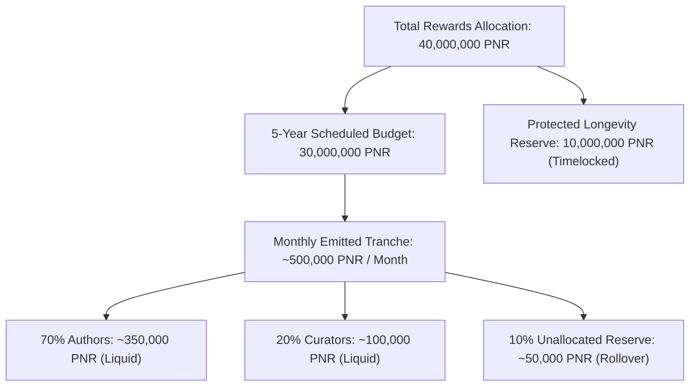

# PENORA — FINANCIAL ARCHITECTURE SPECIFICATION V1 ⚡
## Provisional Founder Decisions: Fixed 100M Supply, 5-Year Reward Plan & Non-Inflationary Tokenomics

**Document Version:** 1.1.0  
**Status:** PROVISIONAL FOUNDER RATIFICATION  
**Ecosystem:** PENORA Blockchain  
**Target Chain:** Polygon Amoy Testnet (Chain ID `80002`) / Polygon Proof-of-Stake Mainnet  
**Fixed Total Supply:** Exactly 100,000,000 PNR (Hard-Capped Genesis Parameter)  

---

## 1. Executive Summary & Core Economic Architecture

PENORA operates under **Model A: Fixed Rewards Pool**, an anti-inflationary economic foundation designed to eliminate token dilution while sustainably funding long-term creator and curator compensation.

### Core Tenets of Model A:
1. **Zero Ongoing Minting:** All 100,000,000 PNR tokens are minted once at genesis. There is no algorithmic inflation, programmatic block emission, or administrative minting capability.
2. **5-Year Creator Reward Plan:** Exactly 40,000,000 PNR (40%) is sequestered in the Creator Rewards Reserve:
   - **30,000,000 PNR:** Programmatically scheduled for emission across Years 1 through 5.
   - **10,000,000 PNR:** Protected reserve held in a non-emitting timelocked vault for longevity and emergency stabilization.
3. **100% Liquid PNR Payouts Initially:** Creators receive 100% of their earned rewards as liquid, transferable PNR. Powering Up into PENORA Power (PP) remains completely voluntary and creator-driven.
4. **Decoupled Key Authorities:** Account publishing permissions remain completely separated from Web3 EVM token custody.
5. **Pricing Honesty:** Financial valuation indicators remain strictly `— USDT` across the interface until verified decentralized exchange (DEX) liquidity and Chainlink oracle feeds exist.

---

## 2. Token Allocation & Balance Sheet Conservation

The total supply of **100,000,000 PNR** is distributed across five dedicated on-chain vaults at genesis.

```
┌────────────────────────────────────────────────────────────────────────────────────────┐
│                        PENORA Token Allocation Balance Sheet                           │
├──────────────────────────────────────┬─────────────┬─────────────────┬─────────────────┤
│ Pool Category                        │ Allocation  │ Amount (PNR)    │ Base Units (wei)│
├──────────────────────────────────────┼─────────────┼─────────────────┼─────────────────┤
│ 1. Creator Rewards Pool              │ 40.0%       │ 40,000,000 PNR  │ 4.0 × 10²⁵ wei  │
│    ├─ 5-Year Scheduled Emission      │ 30.0%       │ 30,000,000 PNR  │ 3.0 × 10²⁵ wei  │
│    └─ Protected Longevity Reserve    │ 10.0%       │ 10,000,000 PNR  │ 1.0 × 10²⁵ wei  │
│ 2. Ecosystem, Guilds & Grants        │ 20.0%       │ 20,000,000 PNR  │ 2.0 × 10²⁵ wei  │
│ 3. Founding Team & Core Contributors │ 15.0%       │ 15,000,000 PNR  │ 1.5 × 10²⁵ wei  │
│ 4. Public Liquidity & DEX Reserve    │ 15.0%       │ 15,000,000 PNR  │ 1.5 × 10²⁵ wei  │
│ 5. Strategic Protocol Treasury       │ 10.0%       │ 10,000,000 PNR  │ 1.0 × 10²⁵ wei  │
├──────────────────────────────────────┼─────────────┼─────────────────┼─────────────────┤
│ TOTAL HARD-CAPPED SUPPLY             │ 100.0%      │ 100,000,000 PNR │ 1.0 × 10²⁶ wei  │
└──────────────────────────────────────┴─────────────┴─────────────────┴─────────────────┘
```

$$\sum_{i=1}^{5} \text{Allocation}_i = 40\% + 20\% + 15\% + 15\% + 10\% = 100.000\% \quad (100,000,000\text{ PNR})$$

---

## 3. The 5-Year Creator Reward Budget (30M Scheduled + 10M Reserve)

The creator rewards reserve contains exactly 40,000,000 PNR. Under the founder-selected plan, **30,000,000 PNR** is scheduled over 5 years ($60\text{ months}$ or $260\text{ weeks}$), and **10,000,000 PNR** is sequestered as a protected reserve.



### 3.1 5-Year Release Schedules: Comparison & Modeling
Two mathematical schedules are modeled for the 30,000,000 PNR budget:

#### Option A: Flat Linear Budget (Predictable Runway)
- Annual Budget: $6,000,000\text{ PNR / year}$
- Monthly Budget: $500,000\text{ PNR / month}$
- Weekly Budget: $115,384.615\text{ PNR / week}$ ($115,384\text{ PNR}$ with $8\text{ PNR}$ weekly remainder deposited to unallocated reserve)

#### Option B: Front-Loaded Early Adopter Decay (Proposed Founder Recommendation)
To maximize initial creator acquisition and community bootstrapping during platform launch:
- **Year 1:** $9,000,000\text{ PNR}$ ($750,000\text{ PNR / month}$ or $173,076.92\text{ PNR / week}$)
- **Year 2:** $7,500,000\text{ PNR}$ ($625,000\text{ PNR / month}$ or $144,230.77\text{ PNR / week}$)
- **Year 3:** $6,000,000\text{ PNR}$ ($500,000\text{ PNR / month}$ or $115,384.62\text{ PNR / week}$)
- **Year 4:** $4,500,000\text{ PNR}$ ($375,000\text{ PNR / month}$ or $86,538.46\text{ PNR / week}$)
- **Year 5:** $3,000,000\text{ PNR}$ ($250,000\text{ PNR / month}$ or $57,692.31\text{ PNR / week}$)
- **Sum Years 1–5:** $9\text{M} + 7.5\text{M} + 6\text{M} + 4.5\text{M} + 3\text{M} = 30,000,000\text{ PNR}$. Exact match.

### 3.2 10,000,000 PNR Protected Longevity Reserve
- **Custodian:** `PenoraProtectedReserveVault.sol`
- **Locking Conditions:** The 10M reserve cannot emit tokens during the initial 5-year period.
- **Activation Gate:** Requires a governance referendum passing with a $\ge 67\%$ supermajority and a 14-day timelock delay, used exclusively to extend platform reward runway into Years 6–10 or fund major ecosystem stabilization.

---

## 4. Reward Distribution Splitting & Payout Policy

For each distribution cycle (monthly tranche or weekly sub-epoch):

| Beneficiary | Percentage | Monthly Amount (Flat Model) | Monthly Amount (Year 1 Front-Loaded) | Payout Asset |
|---|---|---|---|---|
| **Authors (Publishers)** | **70.0%** | $350,000\text{ PNR}$ | $525,000\text{ PNR}$ | 100% Liquid PNR |
| **Curators (Voters)** | **20.0%** | $100,000\text{ PNR}$ | $150,000\text{ PNR}$ | 100% Liquid PNR |
| **Unallocated Reserve** | **10.0%** | $50,000\text{ PNR}$ | $75,000\text{ PNR}$ | Retained in Vault (Rollover) |

### 4.1 100% Liquid PNR Payouts & Voluntary Staking
- Unlike legacy platforms that mandate compulsory 50% staking, PENORA honors **creator sovereignty**:
  - Creators receive **100% Liquid PNR** directly to their connected EVM address.
  - Creators who choose to amplify their curation influence and voting mana can voluntarily execute **Power Up** (1 PNR = 1 PP) via the Hybrid Wallet at any time.
- **Voluntary Power Up Incentive:** Voting influence scales directly with locked PENORA Power ($I = \frac{\text{PP} \times W \times M}{10^8}$). Creators who voluntarily stake gain a competitive advantage in capturing the 20% Curator Reward pool.

### 4.2 The 10% Unallocated Reserve Mechanism
- **Buffer Function:** If an epoch has sparse content, low participation, or invalid/penalized submissions, the unallocated portion plus the baseline 10% is **retained in the reward vault**.
- **Deflationary Rollover:** Unallocated tokens rollover to subsequent epochs or extend the 5-year budget horizon, ensuring zero artificial inflation of subpar content.

---

## 5. Team & Founder Vesting Specification

The **15,000,000 PNR** (15%) allocation for the Founding Team and Core Contributors is deployed into an audited, non-revocable smart contract adhering to strict mathematical parameters:

```
Genesis (T0)               Month 12 Cliff (T0 + 365d)                  Month 48 Final (T0 + 1460d)
     │                                │                                             │
     ▼                                ▼                                             ▼
     [─────── 0% Unlocked ───────────][──────── 36 Months Linear Vesting ───────────]
                                      ▲
                                 Cliff Release:
                             25% (3,750,000 PNR)
```

### 5.1 Exact Vesting Parameters
- **Total Beneficiary Allocation:** $15,000,000\text{ PNR}$ ($1.5 \times 10^{25}\text{ wei}$).
- **Vesting Start Timestamp ($T_0$):** The exact Unix timestamp of the genesis deployment transaction.
- **Cliff Duration:** Exactly $365\text{ days}$ ($31,536,000\text{ seconds}$).
- **Total Vesting Duration:** Exactly $1,460\text{ days}$ ($126,144,000\text{ seconds}$ / 48 months).
- **Cliff Unlock Amount (Month 12):**
  $$\text{Cliff Release} = 15,000,000 \times \frac{12}{48} = 3,750,000\text{ PNR} \quad (25.0\%)$$
- **Remaining Linear Tranche (Months 13–48):**
  $$\text{Post-Cliff Balance} = 15,000,000 - 3,750,000 = 11,250,000\text{ PNR}$$
  - Per-Month Equivalent: $11,250,000 / 36 = 312,500\text{ PNR / month}$.
  - Per-Second Linear Rate ($R_{\text{sec}}$):
    $$R_{\text{sec}} = \left\lfloor \frac{11,250,000 \times 10^{18}}{36 \times 30.4166 \times 86400} \right\rfloor = \left\lfloor \frac{11,250,000 \times 10^{18}}{94,608,000} \right\rfloor \approx 118,911,720,002\text{ wei / second}$$
- **Rounding Rule:** The integer division remainder ($\Delta = 11,250,000\text{ PNR} - (R_{\text{sec}} \times 94,608,000)$) is paid out on the final block of Month 48 to guarantee that not a single wei of PNR is trapped or unvested.
- **Non-Staking Restriction:** Unvested tokens locked in the vesting contract **cannot** be staked into `PenoraPowerEscrow.sol`. Team voting power scales only with genuinely unlocked and voluntarily staked tokens.

---

## 6. Article rewards: seven days from first publication

Founder instruction (22 October 2026): each blog becomes payout-eligible exactly **168 hours after its own first publication**. This replaces the earlier weekly-epoch-plus-48-hour review proposal for new article rewards. Draft creation, editing, unpublishing and republishing do not restart that clock.

- `posts.published_at` is stamped by a database trigger on the first draft-to-published transition (or an initially published insert). `payout_at = published_at + 168 hours` is also server-controlled.
- Existing posts without a verified original publication timestamp remain unscheduled; the migration does not infer publication from draft creation or fabricate historical dates.
- Only canonical confirmed events from the configured voting-influence contract, timestamped within `[published_at, payout_at)`, enter the reward calculation. Social/local votes, late votes and self-votes do not earn rewards.
- Net article influence is `max(0, eligible positive influence - eligible negative influence)`. The funded batch author pool (70%) and curator pool (20%) are shared among articles in proportion to that net influence. Each article's curator share is divided among eligible non-self upvoters by their recorded positive influence. Downvoters do not receive a curator payout.
- At least 10% remains in reserve. Undistributed shares and all integer rounding dust remain reserved. Zero-positive-influence articles receive zero; no tokens are invented to fill an empty pool. Calculations use PNR base-unit integers throughout.
- A settlement operator must reserve a real budget once, select a deterministic complete settlement cohort, and exclude previously settled articles. Splitting a cohort or repeatedly recalculating against the same budget is not a valid settlement policy. Cohort/budget scheduling and the verified event indexer remain backend integration work.
- `PenoraArticleRewards.sol` registers an article's original timestamp through a trusted publisher, accepts an immutable funded allocation root only after maturity, and pays proofs in 100% liquid PNR. Proofs bind chain, distributor, article, recipient and exact amount. Anyone may relay a claim, but the transfer always goes to its committed recipient.
- Seven days is the earliest eligibility boundary, not an automatic blockchain transaction. An operator/relayer must settle the real pool and submit claims; pending, unfunded or unavailable data must never be presented as already paid.
- `PenoraRewardDistributor.sol` remains the legacy weekly-epoch contract. Its 48-hour review semantics are unchanged; it must not be used for the new seven-day article policy. A separate article-rewards deployment and runtime integration are required.

See `docs/PENORA_ARTICLE_REWARDS.md` for integration boundaries and validation.

---

## 7. Power Down & Staking Dynamics

- **Conversion Rate:** 1 PNR = 1 PP (exact 18-decimal parity).
- **Power Down Schedule:** 13 equal weekly installments (1/13th released every 7 days).
  - First installment matures at $T_{\text{start}} + 7\text{ days}$.
  - Final (13th) installment includes the integer division remainder:
    $$\text{Weekly Installment} = \lfloor \frac{\text{Amount}}{13} \rfloor, \quad \text{Remainder} = \text{Amount} - (\text{Weekly} \times 13)$$
- **Instant Influence Deduction:** Starting a Power Down immediately deducts the entire requested amount from available voting power.
- **Cancellation Rule:** Creators can cancel an active Power Down at any time; matured installments are paid immediately, while remaining unvested installments are instantly restored to active PENORA Power.

---

## 8. Unresolved Legal, Economic & Security Risks

Before deploying smart contracts or transferring assets on Polygon Amoy or Mainnet, the following risks must be formally evaluated:

### 8.1 Legal & Regulatory Risks
1. **Utility Token Classification vs. Securities Regulation:** Liquid PNR rewards distributed for content publishing could be scrutinized under the Howey Test or MiCA (Markets in Crypto-Assets) regulation.
   - *Mitigation:* Ensure rewards are strictly characterized as compensation for intellectual property creation and platform curation, with no expectation of profits derived solely from the efforts of founders.
2. **Global Tax Withholding & 1099/DAC8 Compliance:** Directly sending liquid ERC-20 tokens to anonymous wallet addresses creates tax reporting ambiguity in various jurisdictions.
   - *Recommendation:* Consult specialized Web3 legal counsel regarding terms of service and creator disclaimer clauses prior to mainnet launch.

### 8.2 Economic & Game-Theoretic Risks
1. **Curator Ring Collusion:** Cartels of large token holders upvoting low-quality content to extract the 70% author and 20% curator pools.
   - *Mitigation:* The 10% unallocated reserve buffer, sub-linear curation reward formulas, community downvoting signals, and verified funded article settlement.
2. **Initial Liquidity Slippage:** If initial DEX liquidity is insufficient, high reward sell pressure in Year 1 could cause severe price depression.
   - *Mitigation:* The 15M PNR Public Liquidity Reserve must be systematically deployed alongside paired stablecoin reserves with locked LP tokens.

### 8.3 Smart Contract & Operational Risks
1. **Oracle Reliance & USDT Pricing Manipulation:** Using low-liquidity spot DEX pools to calculate USD estimations exposes the frontend to flash-loan price manipulation.
   - *Policy:* Keep valuation strictly as `— USDT` until robust Chainlink price feed contracts are live on Polygon.
2. **Merkle Aggregator Centralization:** If a single off-chain script generates the weekly Merkle root, it presents a single point of failure.
   - *Mitigation:* Open-source the indexing script and require threshold multi-signature validation from independent guild validators before root confirmation.

---

## 9. Codebase Contradictions & Migration Action Items

To align the local codebase at `C:\dev\PENORA-CLEAN` with these provisional founder decisions, the following concrete modifications are required:

1. **Remove `mint()` from `PenoraToken.sol`:**
   - *Current Code:* `function mint(address to, uint256 amount) external onlyOwner`
   - *Required Fix:* Remove `mint()` entirely. Mint the entire 100,000,000 PNR at genesis in the constructor and renounce minting permanently.
2. **Implement `PenoraRewardVault.sol`:**
   - Develop the non-custodial vault holding the 40M Creator Rewards Reserve and dispensing 500,000 PNR/month (or front-loaded equivalent).
3. **Implement `PenoraRewardDistributor.sol`:**
   - Develop the Merkle distribution contract featuring the 48-hour review window and single-claim verification.
4. **Update `src/lib/api/rewards.ts` Currency Format:**
   - Update `$— USD` references to `— USDT` to maintain cross-platform visual consistency.
5. **Add Hardhat Invariant Tests:**
   - Implement automated tests confirming that total allocated supply across all five vaults never exceeds 100,000,000 PNR.

---

## 10. Remaining Approvals Required from Founder

Prior to deploying contracts to Polygon Amoy or finalizing contract bytecode, sign-off is required on:
1. **Reward Curve Selection:** Ratify whether the 30M scheduled creator budget should emit on **Flat Linear** ($500\text{k PNR/month}$) or **Front-Loaded Decay** ($750\text{k}\rightarrow 250\text{k PNR/month}$).
2. **Review Window Duration:** Confirm whether the settlement challenge period should be exactly **48 hours** (recommended) or **72 hours**.
3. **Team Allocation Beneficiary Addresses:** Finalize the multisig address or individual recipient addresses for the 15M Team Vesting contracts.
4. **Initial Liquidity Pairing Ratio:** Confirm the target opening PNR/USDT liquidity ratio for DEX launch.
